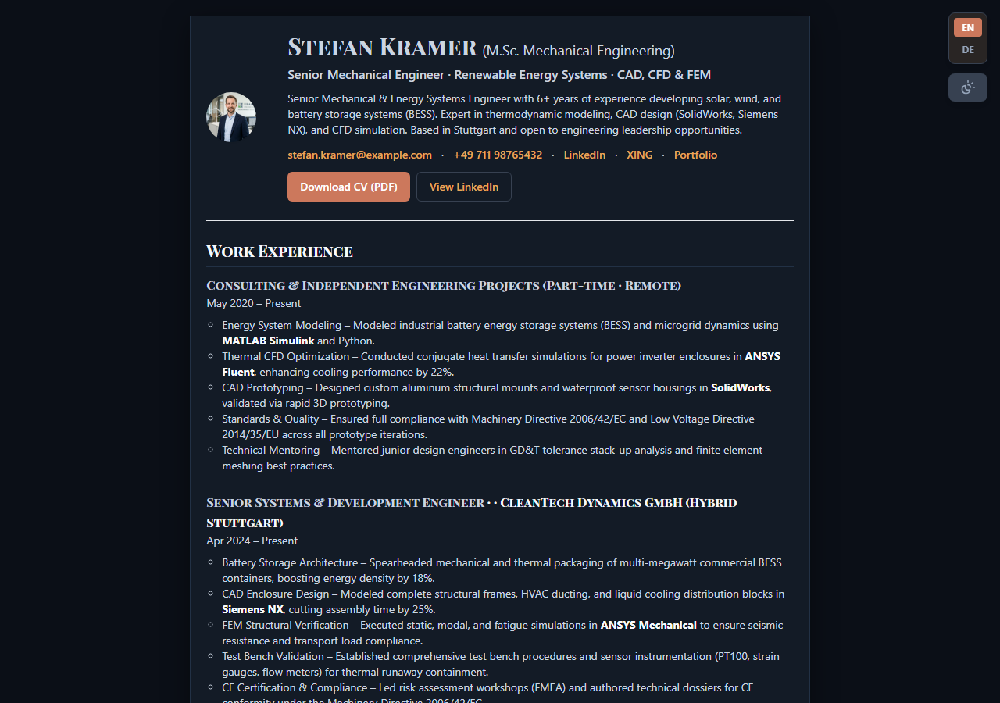

# Career Engine

**Open-source resume and cover letter generator for the German job market: bilingual web CV (DE/EN), DIN 5008 cover letters and ATS-friendly PDFs, all from one JSON profile.**

**[Live demo](https://career.masrisystems.com/resume.html)** (example persona) · [Project page](https://career.masrisystems.com) · [Onboarding guide](ONBOARDING.md)

[](LICENSE.txt)
[](https://python.org)
[](https://tailwindcss.com)

<p align="center"></p>

## Why

Applying for jobs in Germany comes with its own conventions: a Lebenslauf with a photo, a cover letter in DIN 5008 layout, notice period and salary expectation stated up front, and often a German and an English version of everything. Most resume builders ignore these, or let you design for free and then charge for the PDF.

Career Engine keeps your career data in one file and generates everything else from it. No account, no subscription, no watermark.

## Features

- **One profile (`config/profile.json`)**: contact details, target salary, notice period, search preferences and search queries in one place.
- **Bilingual web CV**: switches between German and English in the browser, with light and dark mode.
- **Tailored applications per job**: `jobs/engine.py` builds a tailored resume and a DIN 5008 cover letter for a target company and checks them before export.
- **ATS-friendly PDFs**: single-column semantic HTML exported to A4 through headless Chrome/Edge, so the text stays selectable for applicant tracking systems. A one-click browser export (`html2canvas` + `jsPDF`) is also built in.
- **Daily job search links**: generates a dashboard of search links for LinkedIn, StepStone, Indeed, XING and the Arbeitsagentur from your keywords and locations (`daily-job-search-links.md`).
- **5 role templates** in `jobs/roles/` as starting points for tailoring.
- **AI prompt library**: prompts for onboarding (turn an old CV into the profile file), cover letters, tailoring and interview prep in `jobs/prompts/`.

## Run it with Docker

```bash
git clone https://github.com/masrisystems/career-engine.git
cd career-engine
docker compose up --build
```

Then open `http://localhost` for the project page and `http://localhost/resume.html` for the web CV.

## Quick Start (Python engine)

> **New here?** The [Onboarding Guide (ONBOARDING.md)](ONBOARDING.md) walks you through a 5-minute setup with an AI onboarding prompt (paste your existing resume or answer 7 quick questions).

### 1. Clone & Setup Configuration
Choose from one of the pre-configured profile templates:
- **Fullstack Software Engineer:** `config/profile.example.json` (Alex Morgan, Berlin)
- **Cloud DevOps & Platform Engineer:** `config/profile.devops.example.json` (Elena Becker, Munich)
- **UI/UX & Product Designer:** `config/profile.designer.example.json` (Julian Richter, Hamburg)
- **Banking, Finance & Controlling:** `config/profile.finance.example.json` (Clara Lindemann, Frankfurt)
- **Mechanical & Energy Systems Engineering:** `config/profile.engineering.example.json` (Stefan Kramer, Stuttgart)

Copy your preferred profile template to create your active configuration:
```bash
cp config/profile.example.json config/profile.json
```
Edit `config/profile.json` with your personal details, target salary, notice period, and preferred search locations (or let the [AI Onboarding Prompt](jobs/prompts/onboarding_profile_prompt.txt) generate it automatically from your old resume).
You can also run any engine command directly against a specific profile using `--profile [path]`.

### 2. Render Search Links Dashboard
Generate your personalized job discovery dashboard from your profile:
```bash
python jobs/engine.py build-links
```

### 3. Build Canonical Role Resumes
Compile all 5 pre-validated role archetypes to HTML and PDF:
```bash
python jobs/engine.py build-roles
```

### 4. Apply to a Target Job
Scaffold a new application config for a target company:
```bash
python jobs/engine.py init-config --slug example_tech --date 2026-10-01 --role fullstack_laravel
```
Edit `jobs/configs/2026-10-01_example_tech.json` and run the end-to-end pipeline:
```bash
python jobs/engine.py run --config jobs/configs/2026-10-01_example_tech.json
```
The engine will generate, validate, and export:
- Tailored Resume: `jobs/resumes/example_tech.html` & `example_tech.pdf`
- DIN-5008 Cover Letter: `jobs/cover_letters/2026-10-01_example_tech.html` & `2026-10-01_example_tech.pdf`

---

## Project Structure

```text
career-engine/
├── config/
│   ├── profile.example.json     # Authoritative SSOT schema & defaults
│   └── profile.json             # Active candidate profile
├── index.html                   # Master bilingual web resume (source of truth)
├── style.css                    # Typography, print & PDF stylesheets
├── alex-morgan-profile.webp     # Default candidate profile portrait
├── download.html                # Dedicated download landing helper
├── daily-job-search-links.md    # Generated job search queries & platform links
├── daily-job-search-workflow.md # Daily application intake & tailoring SOP
└── jobs/
    ├── engine.py                # Unified CLI runner for tailoring, cover letters, and PDFs
    ├── job_matches.md           # Opportunity tracker & match scoring matrix
    ├── configs/                 # Job configuration JSONs (YYYY-MM-DD_[company].json)
    ├── job_descriptions/        # Raw job postings & requirements
    ├── cover_letters/           # Generated DIN-5008 HTML & PDF cover letters
    ├── resumes/                 # Generated tailored HTML & PDF resumes
    ├── roles/                   # Pre-validated canonical role archetypes (*.json)
    └── prompts/                 # AI system prompts (Resume, Cover Letter, Prep, Search)
```

---

## License

This project is open-source and available under the [MIT License](LICENSE.txt).

## Professional setup

Want Career Engine set up for you, adapted to your industry, or hosted for a team or career service? [Masri Systems](https://masrisystems.com) offers setup and custom development.
